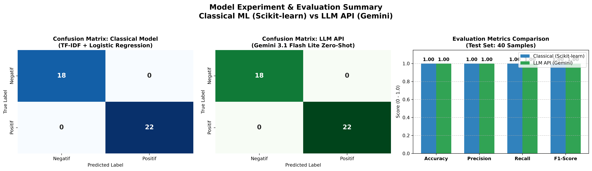

# E-Commerce Sentiment Analysis: Model Experiment & Evaluation

**Author:** Fadhel Arrizky Liranda  
**Repository:** `assignment-model-experiment-fadhelarrizkyliranda`  
**Task:** Binary Sentiment Classification (`positif` vs `negatif`)

---

## 1. Problem Statement & Dataset

- **Objective:** Automatically classify e-commerce customer reviews into positive or negative sentiments to speed up complaint handling and track customer satisfaction.
- **Dataset:** 200 Indonesian customer reviews (`data/customer_reviews_sentiment.csv`).
- **Split:** Stratified 80:20 train/test split (160 train, 40 test; `random_state=42`). Both models are evaluated on the exact same 40 test samples.

---

## 2. Experiment Summary

Two paradigms were compared on the benchmark test set:

1. **Classical Machine Learning:** TF-IDF Vectorizer + Logistic Regression trained on 160 labeled reviews.
2. **LLM API (Zero-Shot):** Google Gemini API (`gemini-3.1-flash-lite`) using strict zero-shot prompting (`temperature=0.2`, max 10 output tokens, single-word constrained output).

---

## 3. Evaluation & Model Comparison

Evaluated on the 40 test samples (22 positive, 18 negative):

| Metric / Parameter       | Classical ML (TF-IDF + Logistic Regression) | LLM API (Gemini 3.1 Flash Lite) | Notes                                                             |
| ------------------------ | ------------------------------------------- | ------------------------------- | ----------------------------------------------------------------- |
| **Accuracy**             | **1.0000 (100%)**                           | **1.0000 (100%)**               | Both models correctly classified all 40 test samples.             |
| **Precision (Positive)** | **1.0000**                                  | **1.0000**                      | Zero false positives across both approaches.                      |
| **Recall (Positive)**    | **1.0000**                                  | **1.0000**                      | Zero false negatives across both approaches.                      |
| **F1-Score (Positive)**  | **1.0000**                                  | **1.0000**                      | Perfect harmonic mean on this test set.                           |
| **Training Time**        | **~0.005 s**                                | **0 s (Zero-shot)**             | Classical model trains in milliseconds; LLM needs no training.    |
| **Inference Latency**    | **< 0.5 ms / sample**                       | **~1.5 - 4.5 s / request**      | Classical model is >3,000x faster (in-memory execution).          |
| **Operational Cost**     | **$0 (Local CPU)**                          | Variable API token cost         | Classical model incurs zero per-request vendor fees.              |
| **Reliability / SLA**    | **100% Offline**                            | Dependent on network & quotas   | LLM is subject to API rate limits (HTTP 429) and network latency. |



---

## 4. Trade-off & Limitations

### Trade-off Analysis

- **Implementation Effort:** LLM wins for immediate prototyping without labeled data; Classical ML requires initial labeling and training setup.
- **Latency & Throughput:** Classical ML is vastly superior for production throughput (< 0.5 ms vs ~3 s per review).
- **Operating Cost:** Classical ML has minimal compute overhead (< 50 MB RAM); LLM incurs recurring token costs that scale with volume.
- **Operational Risk:** Classical ML runs reliably offline; LLM API is constrained by rate limits, latency spikes, and external service availability.

### Limitations

- **Classical ML:** May struggle with subtle sarcasm, double negations, or heavy slang not present in training vocabulary.
- **LLM API:** Susceptible to occasional instruction drift and external network delays.

---

## 5. Technical Recommendation

**Recommended Approach: Classical ML (TF-IDF + Logistic Regression)**

### Rationale

1. **Identical Accuracy:** Matches LLM accuracy (100% on test set) without added complexity.
2. **Ultra-Low Latency:** Sub-millisecond response time enables real-time synchronous UI rendering.
3. **Zero API Cost:** Completely removes recurring token expenses and quota management.
4. **High Availability:** Runs self-contained on CPU infrastructure with zero external failure points.

---

## 6. How to Run

### 1. Setup Environment

```bash
python -m venv venv
source venv/bin/activate  # Windows: .\venv\Scripts\Activate.ps1
pip install -r requirements.txt
```

### 2. Configure API Key (Optional for re-running LLM)

Copy `.env.example` to `.env` and set your API key:

```bash
cp .env.example .env
```

Inside `.env`:

```env
GEMINI_API_KEY=your_gemini_api_key_here
```

\*(Note: Benchmark outputs and predictions are pre-saved in `results.json` and notebook cells).

### 3. Repository Structure

```
assignment-model-experiment-fadhel/
├── data/
│   └── customer_reviews_sentiment.csv
├── documentation/
│   └── model_comparison_summary.png
├── notebook/
│   └── experiment_notebook.ipynb
├── .env.example
├── .gitignore
├── README.md
├── requirements.txt
└── results.json
```

### 4. Run Experiments

- **Via Jupyter Notebook:**
  ```bash
  jupyter notebook notebook/experiment_notebook.ipynb
  ```
- **Via Scripts:**
  ```bash
  python run_experiment.py
  python generate_viz.py
  ```
